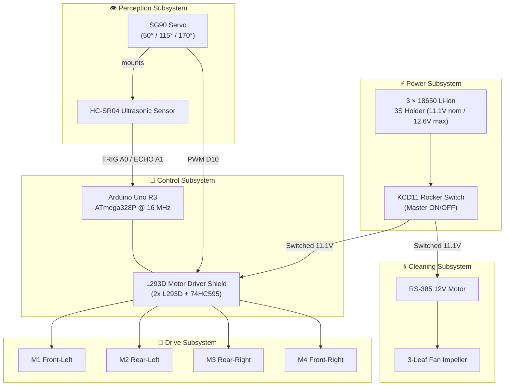
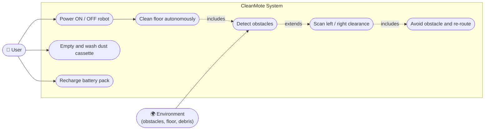
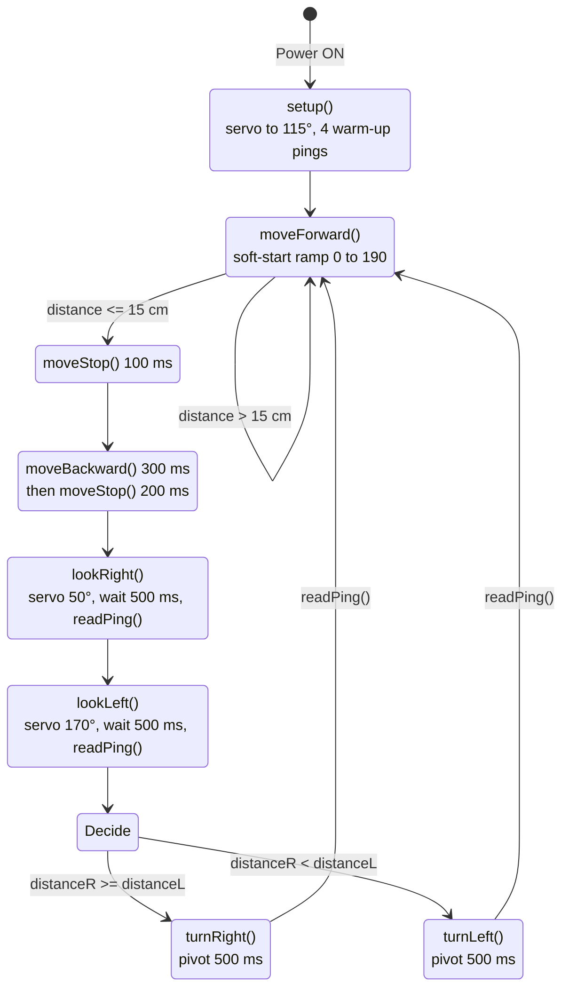
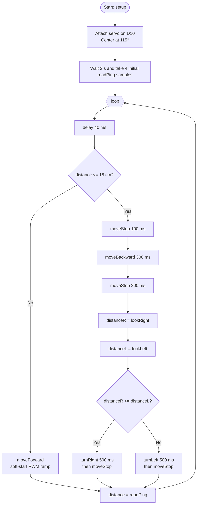
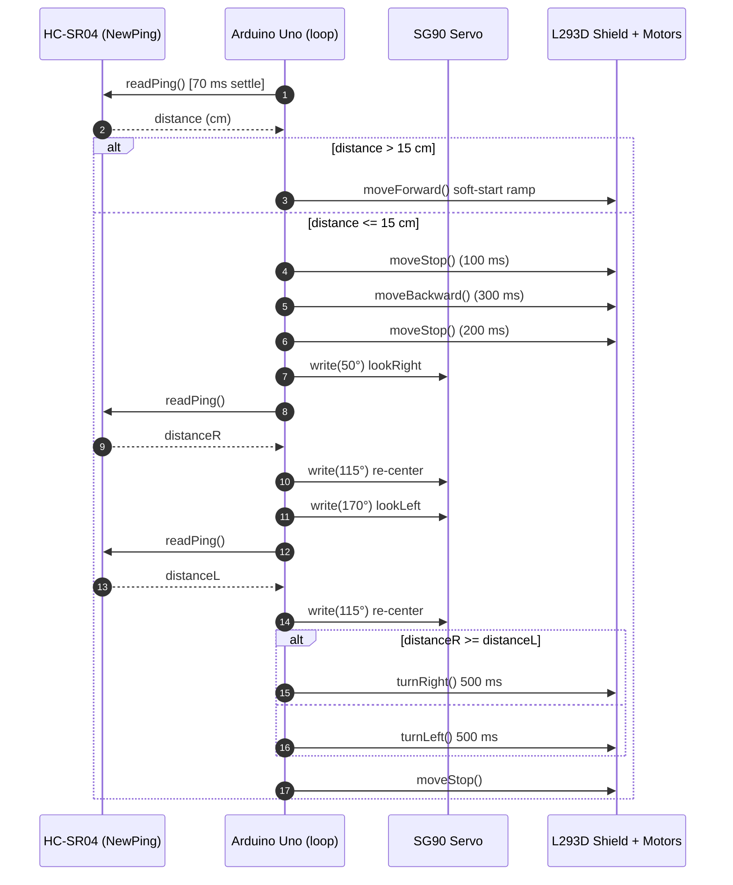
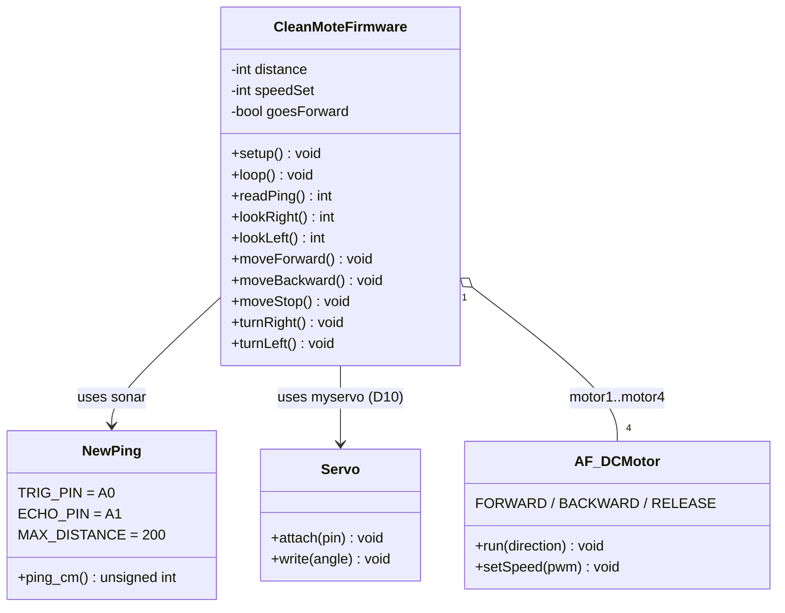
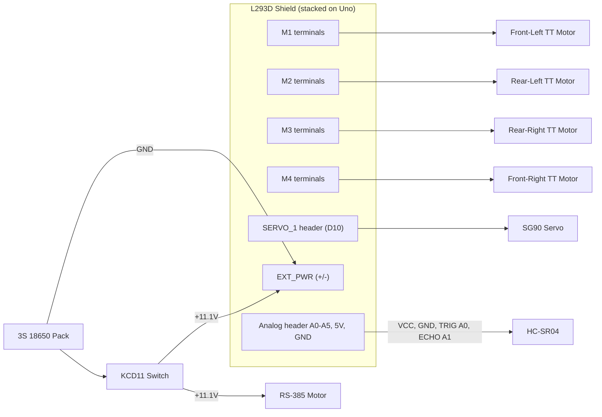
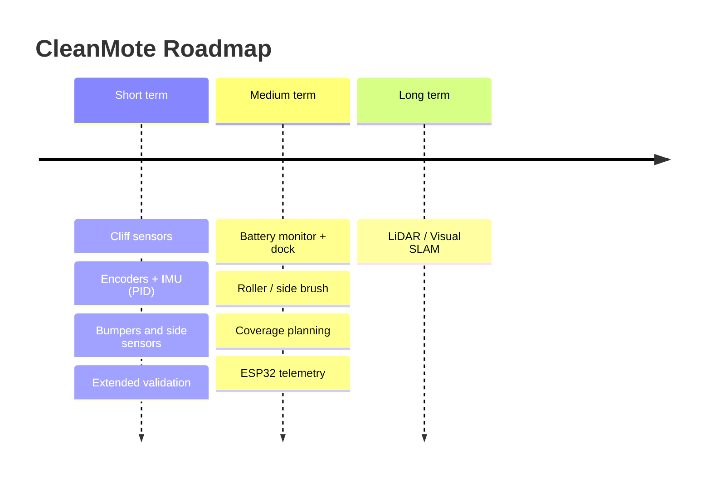

# 🤖 CleanMote: Smart Microcontroller-Driven Autonomous Cleaning Robot


CleanMote is an **open-source, fully offline, privacy-safe** autonomous floor-cleaning robot built around an Arduino Uno R3 (ATmega328P). It uses a servo-mounted HC-SR04 ultrasonic sensor for obstacle avoidance, a 4-wheel-drive differential chassis for movement, and an RS-385 suction turbine for cleaning.

> Bachelor of Science in Information and Communication Engineering project  
> Department of Information and Communication Engineering, Faculty of Engineering  
> **Mawlana Bhashani Science and Technology University (MBSTU)**

---

## 📸 Prototype Gallery

Photographs of the actual CleanMote prototype built and tested in the laboratory.

<p align="center">
  
  <br/>
  <em>Fig. 1: Side view. 4WD chassis, 3S 18650 battery pack, Arduino Uno with L293D shield, and servo-mounted sonar.</em>
</p>

<p align="center">
  
  <br/>
  <em>Fig. 2: Front view. HC-SR04 on the SG90 servo, dust-collection chamber, and the PVC elbow suction intake.</em>
</p>

<p align="center">
  
  <br/>
  <em>Fig. 3: Rear view. RS-385 suction motor with fan inside the duct, battery pack, and wiring.</em>
</p>

---

## 📑 Table of Contents

1. [Prototype Gallery](#-prototype-gallery)
2. [Why CleanMote?](#-why-cleanmote)
3. [Key Features](#-key-features)
4. [Results at a Glance](#-results-at-a-glance)
5. [System Architecture](#-system-architecture)
6. [UML Diagrams](#-uml-diagrams)
7. [Hardware Components](#-hardware-components)
8. [Pin Mapping](#-pin-mapping)
9. [Power Budget](#-power-budget)
10. [Software & Libraries](#-software--libraries)
11. [Getting Started](#-getting-started)
12. [Testing](#-testing)
13. [Limitations](#-limitations)
14. [Future Improvements](#-future-improvements)
15. [Team](#-team)
16. [References](#-references)
17. [License](#-license)

---

## 💡 Why CleanMote?

Commercial robot vacuums (Roomba, Roborock, etc.) are powerful, but they come with closed-source hardware, expensive replacement parts, high power use, and privacy risks from cameras and cloud-uploaded maps. CleanMote offers a **transparent, modular, easily repairable** alternative made from standard off-the-shelf parts.

| | Commercial robots | CleanMote |
|---|---|---|
| Source code | Closed | ✅ Open |
| Repairability | Low | ✅ High (standard COTS parts) |
| Cloud / camera dependency | Yes | ✅ None, 100% offline |
| Cost | High | ✅ Low |

---

## ✨ Key Features

- **4WD differential chassis** with four 6V 100 RPM TT gear motors for stable traction on tile, wood, and concrete.
- **Servo-panning ultrasonic perception:** one HC-SR04 on an SG90 servo scans Right (50°), Center (115°), and Left (170°).
- **Proactive obstacle avoidance:** triggers at a distance of **≤ 15 cm**.
- **Out-of-range protection:** NewPing `0 cm` timeouts (open space beyond 200 cm) are mapped to `250 cm` to avoid false triggers.
- **Soft-start PWM ramping:** speed rises from 0 to 190 in steps of +2 every 5 ms, reducing inrush current and battery voltage sag.
- **Differential pivot steering:** turns toward the side with more clearance.
- **Suction cleaning:** RS-385 12V motor with a 3-leaf fan impeller and a washable slide-out filter cassette.
- **Single-switch operation:** one KCD11 rocker switch, no app or Wi-Fi setup.

---

## 📊 Results at a Glance

| Metric | Measured Value |
|---|---|
| Cruising speed | 0.22 m/s (±0.02) |
| Obstacle detection latency | 38.4 ms (±3.1) |
| Braking distance | 3.2 cm (±0.4) |
| Obstacle avoidance success | **100%** (50/50 trials) |
| Dead-end escape success | **100%** (20/20 trials) |
| Debris pickup efficiency | **86.4%** (43.2 g of 50 g) |
| Battery autonomy | **104 min** (±4.5) |
| Flash / SRAM usage | 14.9% / 16.0% |

*Trials were conducted in a 4.0 m × 4.0 m cluttered laboratory arena.*

---

## 🏗 System Architecture



---

## 📐 UML Diagrams

### 1. Use Case Diagram



### 2. Finite State Machine (Firmware Behavior)



### 3. Activity Diagram (Main Loop)



### 4. Sequence Diagram (Obstacle Avoidance)



### 5. Class Diagram (Firmware Structure)



### 6. Deployment / Hardware Wiring Diagram



---

## 🧰 Hardware Components

| # | Component | Qty | Role |
|---|---|:-:|---|
| 1 | Arduino Uno R3 (ATmega328P) | 1 | Main controller |
| 2 | L293D DC Motor Driver Shield (Dual H-Bridge + 74HC595) | 1 | Drives the 4 traction motors |
| 3 | 6V 100 RPM DC Gear BO Motor (TT, dual shaft) | 4 | Wheel drive (1:48 reduction) |
| 4 | 65×26 mm yellow wheel with rubber tire | 4 | Traction |
| 5 | HC-SR04 ultrasonic sensor | 1 | Distance sensing |
| 6 | 3-leaf plastic fan propeller | 1 | Suction impeller |
| 7 | RS-385 12V brushed DC motor | 1 | Suction motor |
| 8 | SG90 micro servo (180°) | 1 | Sensor panning |
| 9 | 18650 Li-ion 3.7V cells (button top) | 3 | Power source |
| 10 | 18650 3S battery holder with wire | 1 | Series pack (11.1V nominal) |
| 11 | KCD11 mini rocker switch | 1 | Master power switch |
| 12 | Hookup wire and DuPont jumpers | 1 set | Interconnects |

---

## 📌 Pin Mapping

| Component | Pin | Arduino / Shield | Function |
|---|---|---|---|
| HC-SR04 | VCC / GND | +5V / GND | Power |
| HC-SR04 | TRIG | **A0** | Trigger output |
| HC-SR04 | ECHO | **A1** | Echo input |
| SG90 | Signal | **D10** (SERVO_1) | 50 Hz PWM |
| Motor M1 (Front-Left) | M1 terminals | D11 PWM | `MOTOR12_1KHZ` |
| Motor M2 (Rear-Left) | M2 terminals | D3 PWM | `MOTOR12_1KHZ` |
| Motor M3 (Rear-Right) | M3 terminals | D6 PWM | `MOTOR34_1KHZ` |
| Motor M4 (Front-Right) | M4 terminals | D5 PWM | `MOTOR34_1KHZ` |
| 74HC595 shift register | internal | D4, D7, D8, D12 | Motor direction latch |
| RS-385 motor | + / − | Switched 11.1V / GND | Suction |
| Battery pack | + / − | KCD11 Pin 1 / EXT_PWR (−) | Main power |

---

## 🔋 Power Budget

| Load | Current |
|---|---|
| 4 × TT gear motors (cruising) | 640 mA |
| RS-385 suction motor | 280 mA |
| SG90 servo (average) | 40 mA |
| Arduino + HC-SR04 | 45 mA |
| **Total** | **≈ 1,005 mA** |

Estimated runtime: `(2200 mAh / 1005 mA) × 0.85 ≈ 111 min`. Measured: **104 min**.

---

## 💻 Software & Libraries

- Arduino IDE 2.3+ (AVR-GCC)
- [`AFMotor.h`](https://github.com/adafruit/Adafruit-Motor-Shield-library) (Adafruit Motor Shield V1 library)
- [`NewPing.h`](https://bitbucket.org/teckel12/arduino-new-ping/wiki/Home)
- `Servo.h` (built-in)
- Python 3.11 (for the simulation testbench)

---

## 🚀 Getting Started

1. **Assemble the hardware** following the pin mapping and wiring diagram above.
   - Stack the L293D shield on the Arduino Uno.
   - Connect the 4 TT motors to M1–M4, the SG90 to SERVO_1, and the HC-SR04 to A0/A1.
   - Wire the 3S battery pack → KCD11 switch → shield `EXT_PWR` and the RS-385 motor.
2. **Install the libraries** in Arduino IDE (Library Manager): *Adafruit Motor Shield V1 (AFMotor)* and *NewPing*.
3. **Open** `cleanmote.ino`, select **Board: Arduino Uno**, and upload.
4. **Place** the robot on a single-level floor and flip the rocker switch to **ON**.

### Core Firmware Parameters

```cpp
#define TRIG_PIN   A0
#define ECHO_PIN   A1
#define MAX_DISTANCE 200   // cm
#define MAX_SPEED  190     // PWM (0-255)
// Obstacle threshold: distance <= 15 cm
// Servo angles: Right 50°, Center 115°, Left 170°
```

---

## 🧪 Testing

**Unit tests**

| Subsystem | Result |
|---|---|
| HC-SR04 accuracy (10, 25, 50, 100 cm) | ±0.3 cm ✅ |
| SG90 servo sweep | Smooth, latency < 240 ms ✅ |
| 4WD drive (forward / reverse / pivot) | Balanced traction ✅ |
| Vacuum fan | Continuous suction ✅ |

**Automated simulation testbench** (`test_cleanmote.py`): 6 behavioral test cases (clear corridor, noise-spike rejection, right detour, left detour, corner-trap escape, vacuum continuity) all passed.

**Field trials:** 50/50 obstacle-avoidance trials and 20/20 dead-end escapes with no collisions; 86.4% debris pickup.

---

## ⚠️ Limitations

- Single ultrasonic sensor sampled at only three bearings; thin or sound-absorbing objects may be missed.
- No side or rear sensing while moving forward; no cliff / stair detection.
- Reactive navigation only (no mapping, no coverage planning, no docking).
- Open-loop motor control (no encoders or IMU), so heading drift is possible.
- Single suction turbine, no brush or roller; no wet mopping.
- No battery-voltage monitoring or low-battery shutdown.
- Testing was done in one 4 m × 4 m lab arena, so results are indicative.
- 8-bit MCU cannot run SLAM, vision, or a wireless stack without extra hardware.

---

## 🛣 Future Improvements

| Horizon | Improvement |
|---|---|
| Short term | Cliff sensors (TCRT5000), wheel encoders + MPU-6050 with PID control, bumper switches and side sensors, extended validation |
| Medium term | Battery monitoring and charging dock, side brush or roller agitator, zig-zag coverage planning, ESP32 Wi-Fi/BLE telemetry (MQTT) |
| Long term | Low-cost 2D LiDAR or ToF array with an ESP32 / Pico-class controller for SLAM |



---

## 👥 Team

| Name | Student ID |
|---|---|
| MD. Samir Tahrian | IT24007 |
| Apurbo Kumar Roy | IT24008 |
| Ferdous Bin Hafiz | IT24005 |
| Azharul Islam | IT24031 |
| Mohammed Azraf Hossain Afsin | IT24054 |
| Siam Joadder Saisob | IT23049 |

**Supervisor:** Dr. Mst. Nargis Akter, Professor, Department of Information and Communication Engineering, MBSTU

---

## 📚 References

- S. Thrun, W. Burgard, D. Fox, *Probabilistic Robotics*, MIT Press, 2005.
- Microchip, *ATmega328P Datasheet*, DS40002061B.
- STMicroelectronics, *L293D Datasheet*.
- ElecFreaks, *HC-SR04 Ultrasonic Distance Sensor User Manual*.
- J. Borenstein and Y. Koren, "The Vector Field Histogram," *IEEE Trans. Robotics and Automation*, 1991.
- R. Siegwart et al., *Introduction to Autonomous Mobile Robots*, MIT Press, 2011.

---


